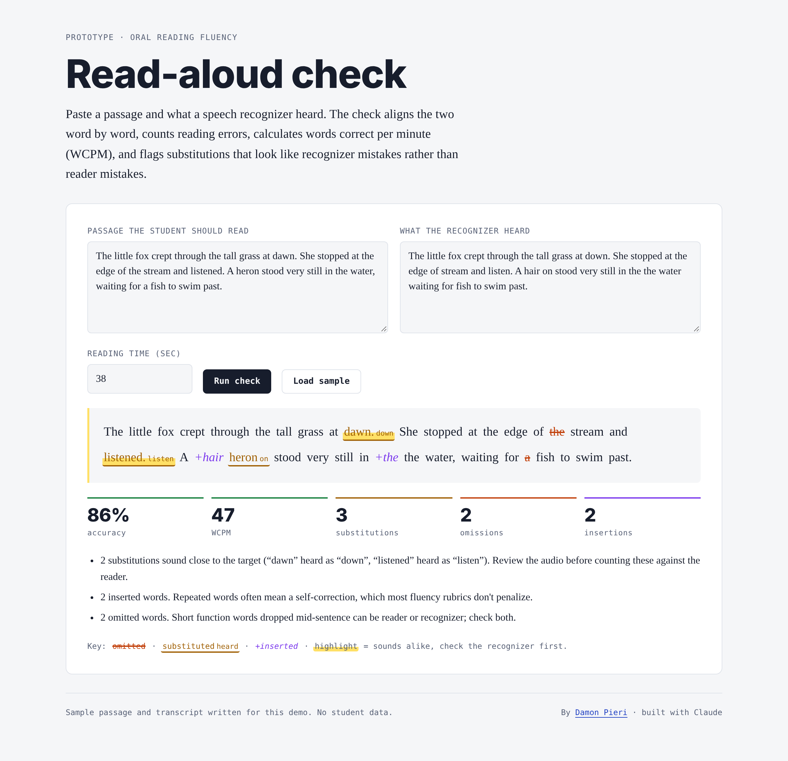

# Read-aloud check

**A prototype for catching the moments when a speech recognizer, not the student, got it wrong.**

👉 **[Try the live demo](https://damonpieri.github.io/read-aloud-check/)**

## The problem

Reading products increasingly score students' oral reading with automated speech recognition (ASR). A student reads a passage aloud, the recognizer transcribes it, and the product counts errors and calculates **words correct per minute (WCPM)**, the standard measure of oral reading fluency.

That works well for confident readers. It breaks down for the students these products matter most for: struggling readers, younger kids, and students with speech or language differences. When the recognizer mishears a correctly read word, the student gets marked wrong. The score drops, the teacher stops trusting it, and the product loses credibility with the people it's meant to help.

The hard part isn't knowing that errors exist. It's separating **reader errors** (real skill gaps a teacher should act on) from **recognizer errors** (engine problems that engineering or a vendor should fix), at a scale where listening to every recording isn't possible.

## What this prototype does

1. **Aligns** the passage the student should have read with what the recognizer heard, word by word, using an edit-distance alignment.
2. **Classifies** every difference as a substitution, omission or insertion, the same categories a teacher uses when scoring a running record by hand.
3. **Calculates** accuracy and WCPM from the reading time.
4. **Flags likely recognizer errors.** These are substitutions where the heard word sounds close to the target, like *dawn* → *down* or *listened* → *listen*. They're the ones to check against the audio before counting them against the reader.
5. **Explains** the result in plain language that a teacher or a product team can act on.

The sample passage and transcript were written for this demo. No student data is included.

## Why I built it

I'm a product manager working on K-12 reading intervention products. At work I built an LLM-assisted workflow with Claude to analyze speech recognition output at scale: it aligns recognizer transcripts against expected text, then sorts the mismatches into patterns so engineering and our vendor get a prioritized, evidence-backed fix list instead of anecdotes.

That workflow runs on proprietary data, so I can't share it. This repo is a public, simplified version of its first step, so the method can be seen and tried.

## PM notes

**Scope decisions**
- **Deterministic first.** The alignment and counts are plain, explainable logic, not an LLM. Scores that affect students need to be reproducible and auditable. In the full workflow, the LLM's job is pattern-finding *across* many alignments, not scoring any single one.
- **Teacher vocabulary.** Substitution, omission and insertion map to how teachers already score reading. That makes the output legible to educators, not just engineers.
- **Flag, don't overrule.** The "sounds alike" check marks words for human review rather than silently changing the score. A false accusation against the recognizer is cheaper than a false accusation against a child, but both should be reviewed.

**Known limitations**
- The "sounds alike" heuristic is spelling-based (shared opening letters, small edit distance), not phonetic. A production version would compare phonemes.
- One word heard as two (*heron* → *hair on*) shows up as an insertion plus a substitution, not a single recognizer split. Detecting splits and merges is a clear next improvement.
- Repeated words are counted as insertions. Most fluency rubrics don't penalize self-corrections, so a real tool should detect and exclude them.
- There's no audio. In practice, the next step is linking each flagged word to its timestamp so a reviewer can listen to just that clip.

**What I'd build next**
- Batch mode: upload many transcript pairs and surface the most frequent recognizer confusions across a whole dataset.
- An LLM pass that groups those confusions into hypotheses (for example "final consonant dropped" or "split compound words") with example clips for engineering.
- A teacher-facing view that shows a corrected score alongside the automated one.

## How it was built

Built with Claude as a single self-contained HTML page: no framework, no build step, no dependencies. Open `index.html` in a browser to run it locally.

## License

MIT. See [LICENSE](LICENSE).

---

**Damon Pieri** · Senior Product Manager, AI-enabled EdTech · [LinkedIn](https://www.linkedin.com/in/damonpieri) · [DYOD on YouTube](https://www.youtube.com/@DYODAI)
